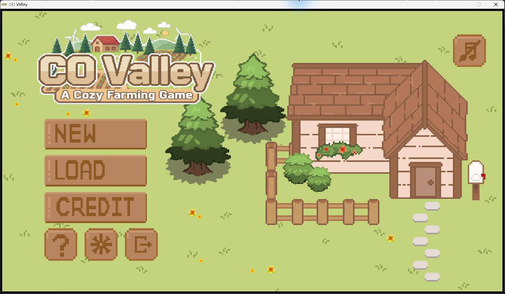

# CO Valley

[](https://github.com/Nuttha-lim/co-valley/actions/workflows/build.yml)

A desktop farming simulation developed by a five-person team using Java 21 and Java Swing. Players explore connected maps, grow crops, manage an inventory, trade items and save their progress.

[ภาษาไทย](docs/README_TH.md) · [Architecture](docs/ARCHITECTURE.md) · [Gameplay test plan](docs/PLAYTEST_CHECKLIST.md) · [Credits](CREDITS.md)



*CO Valley main menu on Windows.*

## My contribution

I designed the game interface and implemented four-direction character movement, directional animations, fence collision and map transitions. I also carried out gameplay testing.

## Review my work

| Area | Source and evidence |
| --- | --- |
| Player movement and direction | [Player.java](src/main/java/Project3_6713120/world/Player.java) |
| Directional animation and sprite rendering | [PlayerLabel.java](src/main/java/Project3_6713120/ui/PlayerLabel.java) |
| Map collision and transitions | [PlayableScene.java](src/main/java/Project3_6713120/ui/PlayableScene.java), [TransitionObject.java](src/main/java/Project3_6713120/ui/TransitionObject.java) |
| Build and testing scope | [Recorded build/startup results](docs/VALIDATION.md), [12 planned gameplay cases](docs/PLAYTEST_CHECKLIST.md) |

These references point into the shared team codebase. The contribution summary above describes my role.

## Features

- Explore multiple scenes with WASD movement and directional character sprites.
- Till soil, plant seeds, water crops and harvest produce.
- Manage a 4 × 6 inventory with item stacks and a six-slot hotbar.
- Buy and sell items in the shop.
- Create a character, use save slots and resume a previous session.
- Access in-game instructions, music settings and team credits.

## Run locally

Install JDK 21 and make sure `java` and `javac` are on PATH. Run the following commands in PowerShell on Windows. The game uses a 1366 × 768 play area, with additional space needed for the window frame.

```powershell
git clone https://github.com/Nuttha-lim/co-valley.git
cd co-valley
powershell -NoProfile -ExecutionPolicy Bypass -File .\scripts\run.ps1
```

The script restores images, fonts and audio from the bundled ZIP, compiles the Java sources and starts the game. Existing restored assets are preserved.

To compile without opening the game:

```powershell
powershell -NoProfile -ExecutionPolicy Bypass -File .\scripts\run.ps1 -BuildOnly
```

Alternatively, open `pom.xml` in IntelliJ IDEA, select JDK 21 and run `Project3_6713120.MainApplication` after running `scripts/prepare-assets.ps1`. Set the working directory to the repository root because assets use relative filesystem paths.

## Controls

| Input | Action |
| --- | --- |
| W / A / S / D | Move up / left / down / right |
| E | Interact with the nearby object or plot |
| 1 to 6 | Select a hotbar slot |
| Tab | Toggle inventory during gameplay |
| Esc | Close inventory or open/exit scene options |

## Source structure

| Path | Responsibility |
| --- | --- |
| `src/main/java/Project3_6713120/MainApplication.java` | Desktop window and application entry point |
| `GameManager.java` in the same package | Scene coordination, input, game updates and saving |
| `world/` | Player movement, interaction, map tiles and farming plots |
| `ui/` | Swing scenes, character rendering, menus and transitions |
| `inventory/` | Item stacks, inventory panels and hotbar |
| `items/` | Item, tool, seed, crop and produce models |
| `data/` | Game data, save snapshots and file persistence |

## Build and testing

All 49 Java source files compile with JDK 21. The application has also been checked through startup to the main menu on Windows. GitHub Actions runs the compilation check on Windows.

See the [build results](docs/VALIDATION.md) and [manual gameplay test plan](docs/PLAYTEST_CHECKLIST.md) for further details.

## Team

The full development team is listed in [CREDITS.md](CREDITS.md).
