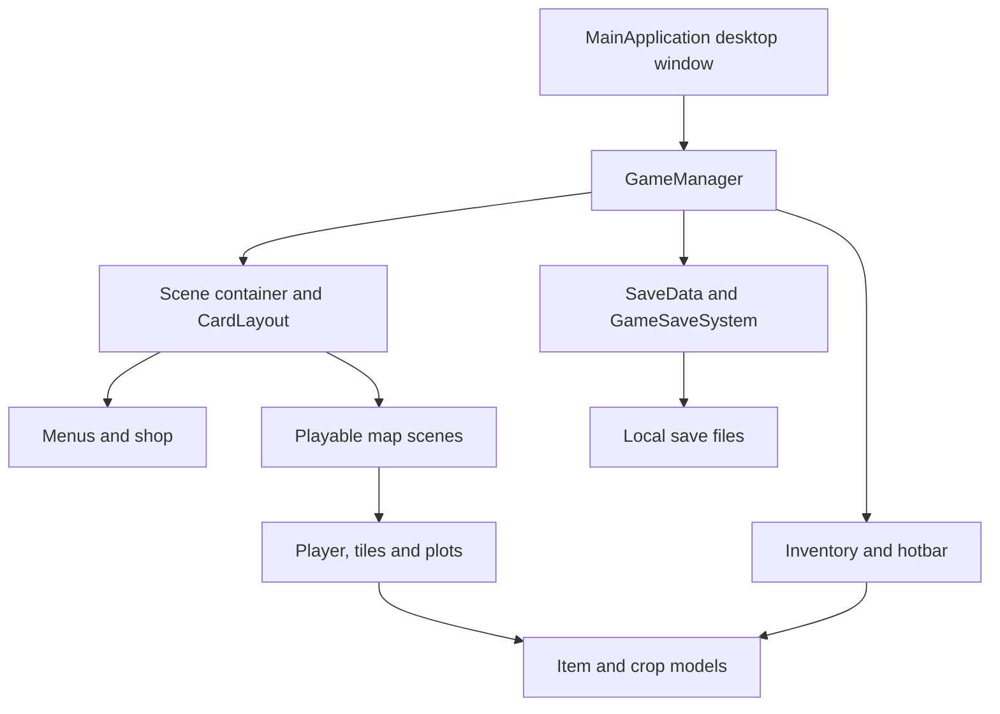

# Architecture

CO Valley is a local Java Swing application. It has no web backend or database dependency. Game state lives in memory during play and is serialized to local `.sav` files.

## Movement and map transitions

`GameManager` receives keyboard input and coordinates updates. `world/Player.java` maintains position and movement state. `ui/PlayerLabel.java` renders character appearance and directional animation. Playable scenes define the map objects and boundaries; transition objects connect scenes.

These files provide a focused review path for Nuttha's documented movement, animation, collision and map-transition work. Source headers attribute the project to the full team and do not establish per-line authorship.

## Presentation and state

`CardLayout` switches between scenes; `JLayeredPane` places the inventory and hotbar above the active scene. `Inventory` stores a grid of slots, and each `ItemStack` holds an item and quantity. Item subclasses distinguish tools, seeds and produce.

## Persistence

`GameSaveSystem` uses `ObjectOutputStream` and `ObjectInputStream` to save and restore `SaveData`. Saves are stored in `src/main/java/Project3_6713120/saves/` and ignored by Git. The existing design includes periodic saving and a save on application close.

## Engineering follow-ups

- Move images, audio and fonts to classpath resources before distributing a standalone JAR.
- Separate input, state updates and persistence from the large `GameManager` class.
- Add regression checks around movement boundaries, map transitions and save/load consistency.
- Review Swing event-thread access and synchronization between updates and periodic saving.
- Document asset provenance and agree a project license with the team before advertising reuse rights.

These are proposed improvements, not completed features.
