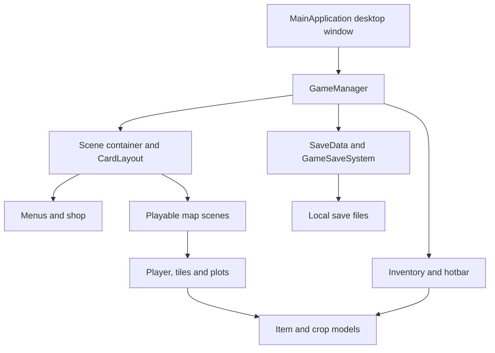

# Architecture

CO Valley is a Java Swing desktop application. Game state stays in memory during play and is serialized to local `.sav` files.

## Movement and map transitions

`GameManager` receives keyboard input and coordinates updates. `world/Player.java` maintains position and movement state. `ui/PlayerLabel.java` renders character appearance and directional animation. Playable scenes define the map objects and boundaries; transition objects connect scenes.

## Presentation and state

`CardLayout` switches between scenes; `JLayeredPane` places the inventory and hotbar above the active scene. `Inventory` stores a grid of slots, and each `ItemStack` holds an item and quantity. Item subclasses distinguish tools, seeds and produce.

## Persistence

`GameSaveSystem` uses `ObjectOutputStream` and `ObjectInputStream` to save and restore `SaveData`. Saves are stored in `src/main/java/Project3_6713120/saves/` and ignored by Git. The existing design includes periodic saving and a save on application close.

## Development notes

- The interface uses a fixed 1366 × 768 play area.
- Images, audio and fonts use paths relative to the repository root.
- Standalone JAR packaging would require changes to resource loading.
- Save files use Java serialization. Load saves created locally by the game.
